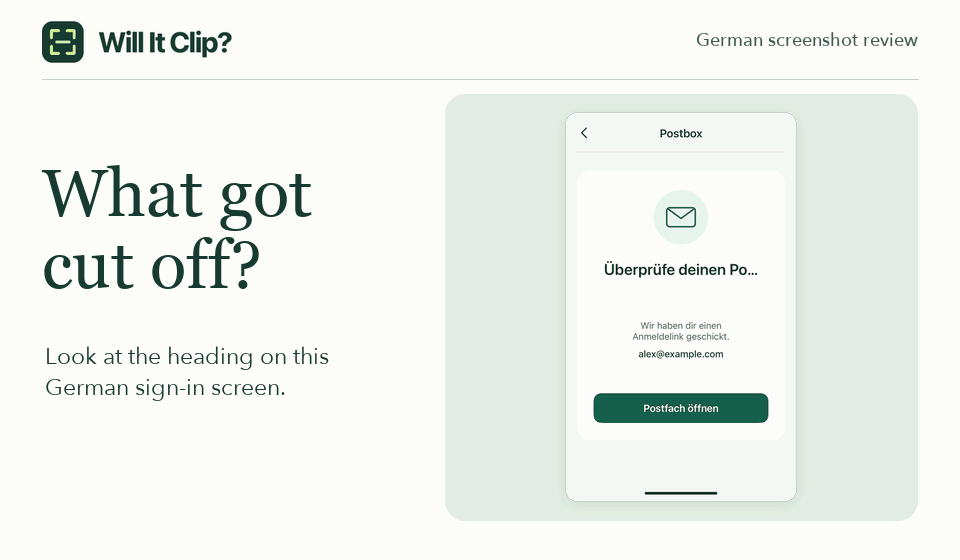

# Will It Clip?

Check whether a translated label fits in an app screenshot. Select the label, paste the full translation, and see which ending is missing. English and German text recognition runs in your browser.

**[Try Will It Clip? in your browser](https://privacy.iamtaoxin.com/will-it-clip/)** · [Run locally](#run-locally) · [简体中文](#简体中文)

Choose **Try a sample screenshot** to see how “Check your inbox” can turn into “Check your bum…” on a small screen. The sample recreates a German title cut short at *Po…*, partway through *Posteingang* (“inbox”). [Original Mastodon iOS report](https://github.com/mastodon/mastodon-ios/issues/1139)

[](https://privacy.iamtaoxin.com/will-it-clip/)

## What the examples show

| Screenshot | Expected text | Result |
| --- | --- | --- |
| `Überprüfe deinen Po…` | `Überprüfe deinen Posteingang` | The visible prefix matches. The missing ending is `steingang`. |
| `Überprüfe deinen`<br>`Posteingang` | `Überprüfe deinen Posteingang` | The full title fits across two lines. |
| `Loading…` | `Loading…` | The ellipsis is part of the expected label. |

## Check your own screenshot

1. Drop a PNG into the inspector and choose the **Text language**. If needed, click **Select area**, then draw a box around one label. Include every line and a little space around the letters.
2. Paste the full label in the same language and click **Compare text**. Check the enlarged crop alongside the recognized text. If the reading is uncertain, try a wider selection.
3. Choose **Confirmed** if you see clipping, or **Expected behavior** if the label looks right. For a bug report, choose **Preview annotated PNG**, then **Download PNG**. The default export includes the selected area and a small border of context.

You can review up to six PNGs per session. Each PNG can be up to 12 MiB and 6 megapixels, with a maximum of 8,192 pixels on either side. The optional **Scan full image** action looks for trailing ellipses. It can miss labels whose letters are cut off without an ellipsis.

**Privacy.** Screenshots, recognized text, and review decisions stay in the current tab. The browser downloads the recognition model for the selected language on first use. **Clear session** removes the screenshots and their results.

## Run locally

Use Node.js 22.12 or later and npm.

```sh
git clone https://github.com/taosin/will-it-clip.git
cd will-it-clip
npm ci
npm run dev
```

Open the local URL printed in the terminal. To preview a production build, run `npm run build` followed by `npm run preview`.

## 简体中文

Will It Clip? 帮你检查多语言界面里的文字有没有被截短。打开体验页，点 **Try a sample screenshot**，就能看到德语标题缺了哪些字母。检查自己的截图时，导入 PNG，框选完整标签，填入同一语言的预期全文，再点 **Compare text**。确认后可以下载带标注的局部截图，附到缺陷报告里。

当前支持英语和德语，截图在浏览器内处理。[在线体验](https://privacy.iamtaoxin.com/will-it-clip/)
