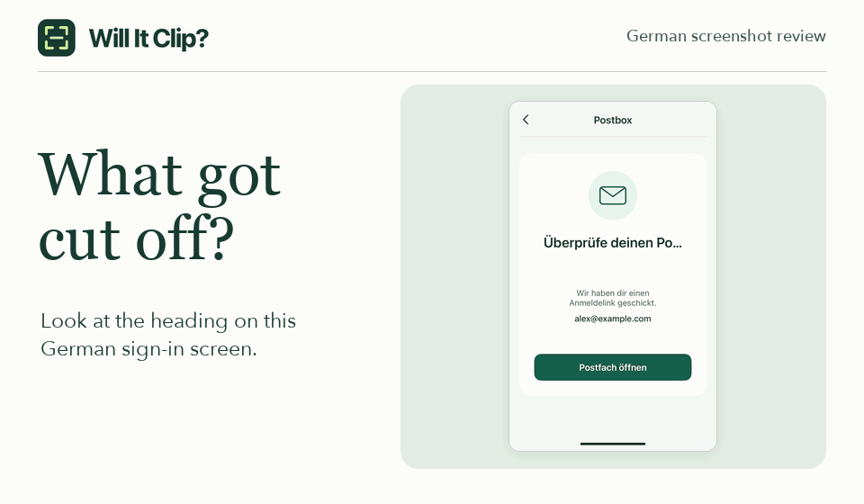

# Will It Clip?

[English](./README.md) | **简体中文**

Will It Clip? 是一个本地化测试工具，用来检查应用截图里的译文是否被截断。在 PNG 截图中框选英语或德语标签，粘贴完整译文。工具会在浏览器内用 OCR 读取截图文字，如果可见部分与译文开头匹配，就会标出末尾缺少的字母。

**[在线试用 Will It Clip?](https://privacy.iamtaoxin.com/will-it-clip/)** · [在本地运行](#在本地运行)

点击 **Try a sample screenshot**，即可查看根据 Mastodon iOS 用户反馈制作的示例。德语标题原本提示用户“查看你的收件箱”，但在小屏幕上，表示“收件箱”的 *Posteingang* 只显示出 *Po…*。恰好 *Po* 在德语口语里是“屁股”的意思，整句就读成了“看看你的屁股……”。[查看原始问题](https://github.com/mastodon/mastodon-ios/issues/1139)

[](https://privacy.iamtaoxin.com/will-it-clip/)

## 示例对照

| 截图中的文字 | 预期全文 | 对照结果 |
| --- | --- | --- |
| `Überprüfe deinen Po…` | `Überprüfe deinen Posteingang` | 可见部分与全文开头一致，末尾少了 `steingang`。 |
| `Überprüfe deinen`<br>`Posteingang` | `Überprüfe deinen Posteingang` | 标题分两行完整显示。 |
| `Loading…` | `Loading…` | 省略号本来就是文案的一部分。 |

## 检查自己的截图

1. 将 PNG 截图拖入页面，在 **Text language** 中选择截图文字的语言。如需指定区域，点击 **Select area**，框住要检查的那段文字。如果文字跨行，请把每一行都框进去，并在四周留一点空白。
2. 粘贴同一语言的完整文案，点击 **Compare text**。对照放大的截图选区和识别出的文字。如果识别不准，可以把选区稍微扩大再试一次。
3. 如果确认文字被截断，选择 **Confirmed**。如果显示符合预期，选择 **Expected behavior**。要把带标注的截图附在问题报告里，先点击 **Preview annotated PNG** 预览，再点击 **Download PNG** 下载。默认导出的图片包含选区及其周围一小圈画面。

每次会话最多可检查 6 张 PNG 截图。每张图片的文件大小不能超过 12 MiB，总像素数不能超过 600 万，宽和高均不能超过 8,192 像素。**Scan full image** 可扫描整张图片，查找末尾带省略号的文字。如果文字被直接裁掉且没有省略号，整图扫描可能会漏掉。

**隐私保护**

截图、识别出的文字和你的判断都保留在当前浏览器标签页中。首次使用某种语言时，浏览器会下载对应的识别模型。点击 **Clear session** 可清除本次会话中的截图和检查结果。

## 在本地运行

需要 Node.js 22.12 或更高版本，以及 npm。

```sh
git clone https://github.com/taosin/will-it-clip.git
cd will-it-clip
npm ci
npm run dev
```

在浏览器中打开终端输出的本地地址。要预览生产构建，依次运行 `npm run build` 和 `npm run preview`。
